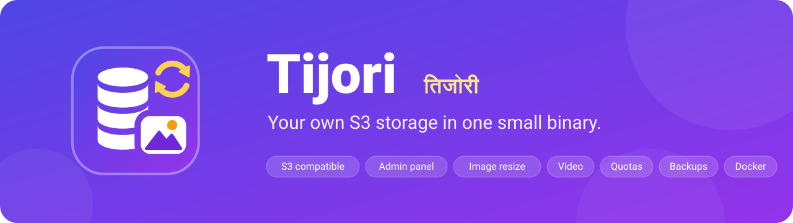
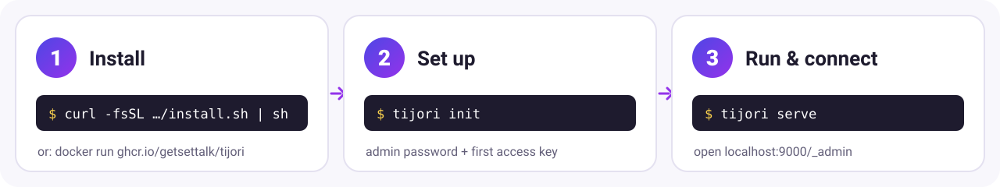
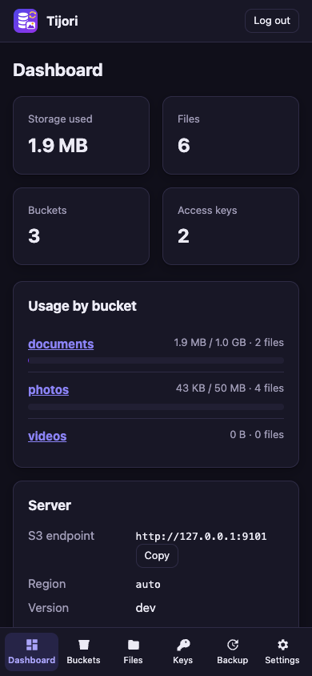
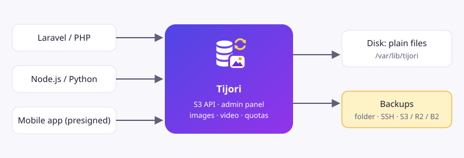

<p align="center">
  
</p>

<p align="center">
  <a href="https://github.com/getsettalk/Tijori/actions/workflows/test.yml"></a>
  <a href="https://github.com/getsettalk/Tijori/releases"></a>
  
  
  <a href="https://github.com/getsettalk/Tijori/pkgs/container/tijori"></a>
  <a href="LICENSE"></a>
</p>

<p align="center">
  <b>Self-hosted, S3-compatible file storage.</b> One file to install, no database to set up,<br>
  works with Laravel, Node.js, Python, Go and mobile apps, and has a built-in admin panel.
</p>

<p align="center">
  <a href="#-quick-start">Quick Start</a> ·
  <a href="#-connect-your-app">Connect your app</a> ·
  <a href="#-admin-panel">Admin panel</a> ·
  <a href="https://getsettalk.github.io/Tijori/">Documentation</a>
</p>

---

*Tijori* means "safe" or "vault". It keeps your app's files (photos, videos,
PDFs, backups) on **your own server**, and any S3 library can talk to it, because
it speaks the same API as Amazon S3.

## ✨ Features

<table>
  <tr>
    <td width="33%" valign="top"><br><b>One small binary</b><br>About 9 MB. No database, no runtime. Linux, macOS, Windows, amd64 and arm64.</td>
    <td width="33%" valign="top"><br><b>S3 compatible</b><br>Buckets, multipart uploads, ranges, copy, presigned URLs and AWS Signature V4.</td>
    <td width="33%" valign="top"><br><b>Admin panel</b><br>File browser with previews, drag-and-drop upload, keys, share links. Works on phones, dark mode.</td>
  </tr>
  <tr>
    <td valign="top"><br><b>Image resizing</b><br><code>/img/photos/cat.jpg?w=300</code> gives a thumbnail, cached on disk.</td>
    <td valign="top"><br><b>Video processing</b><br>Thumbnail and 720p copy with ffmpeg, plus a signed webhook when done.</td>
    <td valign="top"><br><b>Quotas</b><br>Limits per bucket, per file and for the whole server, checked before writing.</td>
  </tr>
  <tr>
    <td valign="top"><br><b>Backups</b><br>Download everything as one file from the admin panel, or back up to a folder, SSH or any S3 service. Restore with one upload.</td>
    <td valign="top"><br><b>Secure by default</b><br>Per-app keys, read/write permissions, CSRF-protected admin, sandboxed HTML.</td>
    <td valign="top"><br><b>Runs anywhere</b><br>Laptop, VPS with systemd, Docker, Docker Compose or Coolify.</td>
  </tr>
</table>

## 🚀 Quick Start

<p align="center"></p>

**1. Install** (Linux or macOS; the script checks the download's SHA256 checksum)

```sh
curl -fsSL https://raw.githubusercontent.com/getsettalk/Tijori/main/scripts/install.sh | sh
```

**2. Set up.** This creates `tijori.toml`, a `data/` folder, an admin password and your first access key.

```sh
tijori init
```

```text
Tijori is ready.

  S3 endpoint:   http://localhost:9000
  Admin panel:   http://localhost:9000/_admin/
  Admin login:   admin / ••••••••••••
  Access key:    tj_4K2M9QX7PL3VB8ZN
  Secret key:    p6Nq••••••••••••••••••••••••••••••••••••
```

**3. Run it** and check it works:

```sh
tijori serve
curl http://localhost:9000/health      # {"status":"ok"}
```

Open **http://localhost:9000/_admin/**, log in as `admin`, create a bucket and upload a file. 🎉

<details>
<summary><b>🐳 Docker</b></summary>

```sh
docker run -d --name tijori -p 9000:9000 \
  -v tijori-data:/data \
  -e TIJORI_ADMIN_PASSWORD=change-me-please \
  ghcr.io/getsettalk/tijori:latest
```

Use `ghcr.io/getsettalk/tijori:latest-ffmpeg` for video processing. For Docker Compose, see
[deploy/docker-compose.yml](deploy/docker-compose.yml). For Coolify, see [docs/coolify.md](docs/coolify.md).
</details>

<details>
<summary><b>🖥️ Linux server (systemd)</b></summary>

```sh
curl -fsSL https://raw.githubusercontent.com/getsettalk/Tijori/main/scripts/install.sh | sudo sh
sudo tijori init --public-url https://files.example.com   # config in /etc/tijori, data in /var/lib/tijori
sudo tijori service install                               # starts now and on every boot
```

Put Caddy or Nginx in front for HTTPS: [docs/https.md](docs/https.md).
</details>

<details>
<summary><b>🪟 Windows</b></summary>

Download `tijori_<version>_windows_amd64.zip` from [Releases](https://github.com/getsettalk/Tijori/releases), unzip it, then:

```powershell
.\tijori.exe init
.\tijori.exe serve
```
</details>

<details>
<summary><b>🛠️ Build from source</b> (Go 1.26+)</summary>

```sh
git clone https://github.com/getsettalk/Tijori.git
cd Tijori
CGO_ENABLED=0 go build -trimpath -ldflags "-s -w" -o tijori ./cmd/tijori
./tijori version
```

Cross-compiling for other systems, Docker images and verifying builds:
[docs/build-from-source.md](docs/build-from-source.md).
</details>

<details>
<summary><b>☁️ Coolify</b> (recorded walkthrough)</summary>

<p></p>

Step-by-step guide with screenshots: [docs/coolify.md](docs/coolify.md).
</details>

## 🔌 Connect your app

Every S3 client needs the same settings:

| Setting | Value |
| --- | --- |
| Endpoint | `http://localhost:9000` (or `https://files.example.com`) |
| Region | `auto` (any value works) |
| Access key / Secret key | from `tijori init`, or **Keys → New key** in the admin panel |
| Path-style URLs | **on** |

<details open>
<summary><b>Laravel</b> (<code>.env</code>)</summary>

```sh
composer require league/flysystem-aws-s3-v3 "^3.0" --with-all-dependencies
```

```env
FILESYSTEM_DISK=s3
AWS_ACCESS_KEY_ID=tj_XXXXXXXXXXXXXXXX
AWS_SECRET_ACCESS_KEY=your-secret
AWS_DEFAULT_REGION=auto
AWS_BUCKET=my-app
AWS_ENDPOINT=http://localhost:9000
AWS_USE_PATH_STYLE_ENDPOINT=true
```

```php
$path = $request->file('avatar')->store('avatars');                 // upload
$url  = Storage::temporaryUrl($path, now()->addMinutes(10));        // private link
Storage::copy('avatars/a.jpg', 'backup/a.jpg');                     // copy, move, delete…
```
</details>

<details>
<summary><b>Node.js</b> (<code>@aws-sdk/client-s3</code>)</summary>

```js
import { S3Client, PutObjectCommand, GetObjectCommand } from "@aws-sdk/client-s3";
import { getSignedUrl } from "@aws-sdk/s3-request-presigner";

const s3 = new S3Client({
  endpoint: "http://localhost:9000",
  region: "auto",
  forcePathStyle: true,
  credentials: { accessKeyId: "tj_XXXXXXXXXXXXXXXX", secretAccessKey: "your-secret" },
});

await s3.send(new PutObjectCommand({ Bucket: "my-app", Key: "hello.txt", Body: "Hello, Tijori!" }));
const link = await getSignedUrl(s3, new GetObjectCommand({ Bucket: "my-app", Key: "hello.txt" }), { expiresIn: 3600 });
```
</details>

<details>
<summary><b>Python</b> (<code>boto3</code>)</summary>

```python
import boto3
from botocore.config import Config

s3 = boto3.client("s3", endpoint_url="http://localhost:9000", region_name="auto",
                  aws_access_key_id="tj_XXXXXXXXXXXXXXXX", aws_secret_access_key="your-secret",
                  config=Config(s3={"addressing_style": "path"}))

s3.upload_file("report.pdf", "my-app", "reports/report.pdf")   # big files use multipart automatically
url = s3.generate_presigned_url("get_object", Params={"Bucket": "my-app", "Key": "reports/report.pdf"}, ExpiresIn=600)
```
</details>

<details>
<summary><b>Go</b> (<code>aws-sdk-go-v2</code>)</summary>

```go
client := s3.New(s3.Options{
    Region:       "auto",
    BaseEndpoint: aws.String("http://localhost:9000"),
    UsePathStyle: true,
    Credentials:  credentials.NewStaticCredentialsProvider("tj_XXXXXXXXXXXXXXXX", "your-secret", ""),
})
_, err := client.PutObject(ctx, &s3.PutObjectInput{
    Bucket: aws.String("my-app"), Key: aws.String("hello.txt"), Body: strings.NewReader("hi"),
})
```
</details>

<details>
<summary><b>curl</b> and the <b>AWS CLI</b></summary>

```sh
# curl 7.75+ signs requests itself
curl --aws-sigv4 "aws:amz:auto:s3" --user "tj_XXXXXXXXXXXXXXXX:your-secret" \
     -T photo.jpg http://localhost:9000/my-app/photo.jpg

# AWS CLI
aws --endpoint-url http://localhost:9000 s3 cp photo.jpg s3://my-app/
aws --endpoint-url http://localhost:9000 s3 ls s3://my-app/
```
</details>

<details>
<summary><b>📱 Mobile apps</b> (Flutter / React Native, without shipping your secret)</summary>

Your backend creates a short-lived **presigned upload URL**; the app uploads straight to Tijori:

```js
// React Native / browser
const { url } = await (await fetch("https://api.example.com/upload-url", { method: "POST" })).json();
await fetch(url, { method: "PUT", body: fileBlob, headers: { Accept: "application/json" } });
```

```dart
// Flutter
final r = await http.post(Uri.parse('https://api.example.com/upload-url'));
await http.put(Uri.parse(jsonDecode(r.body)['url']), body: await file.readAsBytes());
```

Full guide with backend code: [docs/mobile.md](docs/mobile.md). Uploading from a **web page**?
Allow its address with `cors_origins = ["https://app.example.com"]` (CORS).
</details>

## 🖼️ Image resizing

Change the URL, get a smaller image. The original is never touched and results are cached.

| URL | Result |
| --- | --- |
| `/img/photos/beach.jpg?w=800` | 800 px wide |
| `/img/photos/beach.jpg?w=200&h=200&fit=cover` | square thumbnail, cropped |
| `/img/photos/beach.jpg?w=400&q=70&fmt=jpeg` | smaller JPEG |

Public buckets work as-is; private buckets use a presigned `/img/...` URL. Phone photos are rotated
correctly. Details: [docs/images.md](docs/images.md).

## 🎬 Video processing

With ffmpeg installed, turn it on for a bucket:

```toml
[buckets.videos]
video_process = true

[video]
webhook = "https://yourapp.com/hooks/tijori"
webhook_secret = "a-long-random-string"
```

Uploading `trips/goa.mp4` creates `trips/goa.jpg` (thumbnail) and `trips/goa_720p.mp4`, then sends a
signed webhook to your app. Details: [docs/video.md](docs/video.md).

## 🧭 Admin panel

<p>
  
  
</p>

Dashboard with usage bars · buckets with quotas and public switch · file browser with previews,
search and drag-and-drop · access keys (the secret is shown once, with ready Laravel/Node settings) ·
share links · backups · settings. Read-only users too: `tijori admin password --user viewer --readonly`.

## 💾 Backups and moving servers

**No extra server needed:** in the admin panel, **Backup → Download backup** saves everything
(buckets, files, keys, settings) as one file on your computer. **Restore from a backup file**
brings it back, on the same or a new server, while it runs. The file is checked completely before
anything changes.

From a terminal:

```sh
tijori backup --to /mnt/backup/tijori                     # folder, sftp://user@host/path or s3://bucket?endpoint=...
tijori restore --from /mnt/backup/tijori

tijori export --out tijori-backup.tar.gz                  # everything in one file: data, keys, config
tijori import tijori-backup.tar.gz                        # on the new server
```

Scheduled backups: `[backup] to = "..."`, `schedule = "daily 03:00"`, `keep = 7`.
Moving to a new server step by step: [docs/backup.md](docs/backup.md).

## ⚙️ Configuration

Everything works with defaults. Settings live in `tijori.toml`, and **every setting can also be an
environment variable** (`listen` → `TIJORI_LISTEN`, `[images] max_width` → `TIJORI_IMAGES_MAX_WIDTH`).

```toml
listen     = ":9000"
data_dir   = "/var/lib/tijori"
public_url = "https://files.example.com"
max_total  = "100GB"
error_format = "auto"      # XML errors for S3 SDKs, JSON when a client sends Accept: application/json

[buckets.photos]
public_read = true
max_size = "10GB"
max_object_size = "20MB"
```

Full reference: [docs/configuration.md](docs/configuration.md).

## 🧰 CLI cheatsheet

| Command | What it does |
| --- | --- |
| `tijori serve` | Start the server |
| `tijori init` | Create config, admin password and first key |
| `tijori key create --name app --buckets photos --permission read` | New access key |
| `tijori bucket create photos --public --max-size 10GB` | New bucket |
| `tijori usage` | Space used per bucket |
| `tijori backup` / `restore` / `export` / `import` | Backups and moving servers |
| `tijori service install` | Run as a service (systemd / launchd) |
| `tijori doctor` | Check config, permissions, disk, ffmpeg and port |

All commands: [docs/cli.md](docs/cli.md).

## 🏗️ How it works

<p align="center"></p>

Files are stored as **plain files** (`data/buckets/<bucket>/<key>`), so tools like `rsync`, `restic`
and `borg` work too. Tijori is for one server: there's no clustering, versioning or IAM policies. For
those, look at [Garage](https://garagehq.deuxfleurs.fr/) or [SeaweedFS](https://github.com/seaweedfs/seaweedfs).

## 📚 Documentation

| Get started | Connect | Features | Reference |
| --- | --- | --- | --- |
| [What is Tijori](docs/index.md) | [Laravel](docs/laravel.md) | [Image resizing](docs/images.md) | [Configuration](docs/configuration.md) |
| [Quick Start](docs/quick-start.md) | [Node.js](docs/nodejs.md) | [Video](docs/video.md) | [CLI](docs/cli.md) |
| [VPS install](docs/install-vps.md) | [Mobile apps](docs/mobile.md) | [Admin panel](docs/admin-panel.md) | [Troubleshooting](docs/troubleshooting.md) |
| [Docker](docs/docker.md) · [Coolify](docs/coolify.md) | | [Quotas](docs/quotas.md) | [Security](docs/security.md) |
| [Build it yourself](docs/build-from-source.md) | | | |
| [HTTPS](docs/https.md) | | [Backups](docs/backup.md) | |

**🤖 Using an AI assistant?** Give it [`llms-full.txt`](docs/llms-full.txt)
([online](https://getsettalk.github.io/Tijori/llms-full.txt)): the whole manual in one file, so
ChatGPT, Claude, Cursor and similar tools answer questions about Tijori correctly. The short
index is [`llms.txt`](https://getsettalk.github.io/Tijori/llms.txt) in the [llms.txt](https://llmstxt.org) format.

## 🤝 Contributing

Issues and pull requests are welcome. Please read [CONTRIBUTING.md](CONTRIBUTING.md). Run the
tests with `go test -race ./...`. Report security problems privately: [SECURITY.md](SECURITY.md).

## 📄 License

[Apache-2.0](LICENSE)
