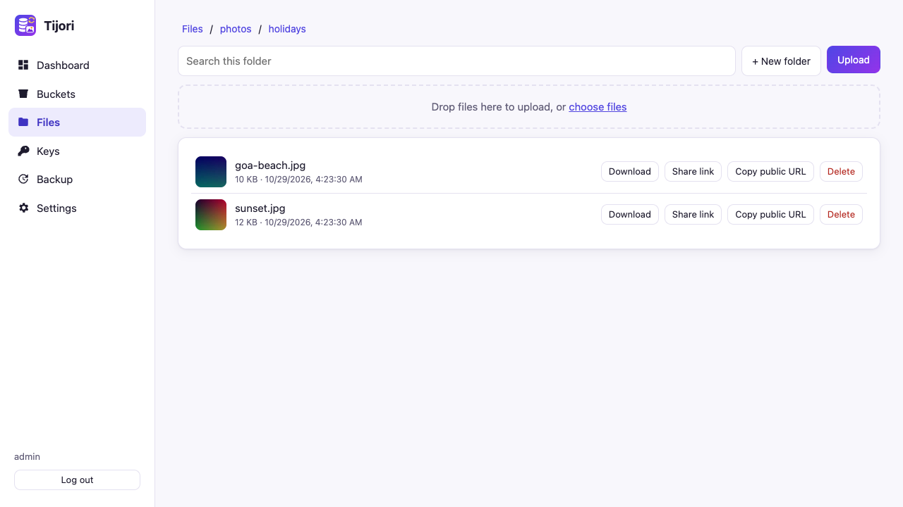

# Admin panel tour

**You will:** know where everything is in the built-in admin panel.

Open `https://your-server/_admin/` and log in. The first user is `admin`;
its password comes from `tijori init` or the `TIJORI_ADMIN_PASSWORD` variable.



## Dashboard

Total storage used, file and bucket counts, a usage bar for each bucket with
a quota, server version, free disk, whether ffmpeg was found, image cache size
and the last backup result.

## Buckets

Create, edit and delete buckets. For each one you can set:

- **Public**: anyone with the link can download (never upload).
- **Quota** and **Max file size**: for example `10GB` and `500MB`.
- **Video processing**: see [Video processing](video.md).

Buckets defined in `tijori.toml` show "Settings come from tijori.toml" and can only be changed there.

## Files

- Folders, a breadcrumb trail and **search** within the current folder.
- **Upload** with the button or by dragging files onto the page (with progress bars).
- Click a file to **preview** it: images, video and audio play in place; PDFs open in a new tab.
- **Download**, **Share link** (a presigned link valid for 15 minutes to 7 days),
  **Copy public URL** (public buckets) and **Delete**.
- **New folder**, and deleting a folder removes everything inside it after you confirm.

## Keys

Create a key for each app. Choose the buckets it may use and whether it may
read, write or both. The secret is shown **once**, together with ready-made
Laravel and Node.js settings. **Revoke** stops a key immediately.

## Backup

Shows the destination, schedule and last result, and has a **Run backup now** button.

## Settings

Switch theme (auto, light, dark), change your password, and see the effective configuration (secrets are hidden).

## Read-only users

Create a user who can look but not change anything:

```sh
tijori admin password --user viewer --readonly
```

## Security

- Sessions use `HttpOnly`, `SameSite=Strict` cookies (`Secure` behind HTTPS) and expire after 12 hours.
- Every change needs a CSRF token; logins are rate limited.
- To keep the panel off the public internet, serve it on its own address:

    ```toml
    [admin]
    listen = "127.0.0.1:9001"
    ```

    then reach it through an SSH tunnel: `ssh -L 9001:127.0.0.1:9001 you@server`.
- Or turn it off completely: `enabled = false`.
