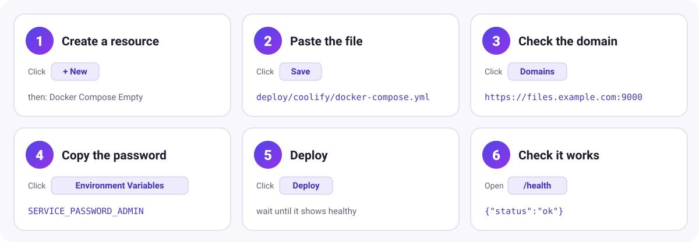
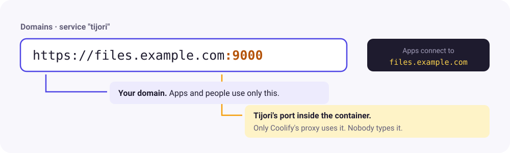

# Coolify

**You will:** run Tijori on [Coolify](https://coolify.io) at your own domain, with HTTPS, in about 10 minutes.

!!! info "Coolify version"
    Written for **Coolify v4.4**, the current stable line (October 2026). Coolify v5 is not
    released yet. Button names may differ slightly in other versions.

## How it fits together


- Your apps and users only ever use **your domain**, for example `https://files.example.com`.
- Coolify's proxy gets the HTTPS certificate and forwards traffic to Tijori's port `9000`.
- Your files live in the Docker volume **`tijori-data`**, so they survive redeploys and upgrades.

## Before you start

- A server with Coolify installed, and a project to put Tijori in.
- A domain or subdomain (for example `files.example.com`) with a DNS **A record** pointing to
  your Coolify server's IP address. Without your own domain, Coolify can generate one if a
  wildcard domain is set in the server settings.

## The six steps



### 1. Create the resource

Open your project and environment, click **+ New**, and choose **Docker Compose Empty**.
If Coolify asks, choose the server to run it on.

### 2. Paste the Compose file

Copy everything below into the **Docker Compose file** box and click **Save**.
(It is also in the repository as [deploy/coolify/docker-compose.yml](https://github.com/getsettalk/Tijori/blob/main/deploy/coolify/docker-compose.yml).)

```yaml
services:
  tijori:
    image: ghcr.io/getsettalk/tijori:latest
    restart: unless-stopped
    environment:
      - SERVICE_URL_TIJORI_9000
      - TIJORI_PUBLIC_URL=${SERVICE_URL_TIJORI}
      - TIJORI_ADMIN_PASSWORD=${SERVICE_PASSWORD_ADMIN}
      - TIJORI_ACCESS_KEY=${TIJORI_ACCESS_KEY:-}
      - TIJORI_SECRET_KEY=${TIJORI_SECRET_KEY:-}
    volumes:
      - tijori-data:/data
    healthcheck:
      test: ["CMD", "/usr/local/bin/tijori", "healthcheck"]
      interval: 30s
      timeout: 5s
      retries: 3

volumes:
  tijori-data:
```

What the special lines do:

| Line | Meaning |
| --- | --- |
| `SERVICE_URL_TIJORI_9000` | Coolify gives the `tijori` service a domain and sends its traffic to port `9000`. |
| `${SERVICE_URL_TIJORI}` | Coolify fills in the full address, like `https://files.example.com`. |
| `${SERVICE_PASSWORD_ADMIN}` | Coolify generates a strong admin password once and keeps it. |
| `${TIJORI_ACCESS_KEY:-}` | An optional variable you can fill in later. |

There is no `ports:` section on purpose. Coolify's proxy handles traffic, and publishing a
port would bypass HTTPS.

### 3. Set the domain

Open **Domains** (or the service's settings) and make sure the `tijori` service has your domain
**with `:9000` at the end**:



```text
https://files.example.com:9000
```

The `:9000` only tells the proxy which port Tijori listens on. Your apps and browser still use
`https://files.example.com` without a port.

### 4. Copy the admin password

Open **Environment Variables**. You will see `SERVICE_PASSWORD_ADMIN` with a generated value.
Copy it: it is the password for the user **`admin`**.

Optional: to give your app a ready-made key, set `TIJORI_ACCESS_KEY` (for example
`tj_MYAPP0000000001`) and `TIJORI_SECRET_KEY` (at least 8 characters; 40 random characters
is better). Set both, or leave both empty and create keys in the admin panel later.

### 5. Deploy

Click **Deploy** and open the deployment logs. After a few seconds you should see
`Tijori started` and `S3 endpoint ready`, and the service turns **healthy**.

### 6. Check it works

- Open `https://files.example.com/health`. It should show `{"status":"ok"}`.
- Open `https://files.example.com/_admin/` and log in as `admin` with the password from step 4.
- Create a bucket, then go to **Keys → New key** to get the settings for your app.

## Connect your app

Use your domain as the endpoint, with path-style URLs turned on:

```env
AWS_ENDPOINT=https://files.example.com
AWS_DEFAULT_REGION=auto
AWS_USE_PATH_STYLE_ENDPOINT=true
AWS_ACCESS_KEY_ID=tj_...
AWS_SECRET_ACCESS_KEY=...
AWS_BUCKET=my-app
```

See [Laravel](laravel.md), [Node.js](nodejs.md) and [Mobile apps](mobile.md) for full examples.

## Video processing

Change the image to `ghcr.io/getsettalk/tijori:latest-ffmpeg`, click **Save**, then
**Redeploy**. Then turn on **Video processing** for a bucket in the admin panel.

## Upgrading

Click **Redeploy** to pull the image again. If you prefer controlled upgrades, use a version tag
such as `ghcr.io/getsettalk/tijori:1.0.0` and change it when you want to upgrade. Your files stay
in the `tijori-data` volume either way.

## Backups and moving to another server

- **Scheduled backups:** add environment variables `TIJORI_BACKUP_TO`
  (for example `s3://my-backups?endpoint=https://...`), `TIJORI_BACKUP_SCHEDULE=daily 03:00`, and for
  S3 destinations `TIJORI_BACKUP_ACCESS_KEY` and `TIJORI_BACKUP_SECRET_KEY`. Redeploy.
- **One-file export:** open the service's **Terminal** in Coolify and run
  `tijori export --out /data/export.tar.gz`, then copy the file off the server.
- **Copy the volume:** on the server, `docker volume ls | grep tijori-data` finds the volume and
  `docker volume inspect <name>` shows its folder. Copy that folder with `rsync -a`.

To move: deploy Tijori on the new Coolify server, copy `export.tar.gz` into the container's
`/data` folder, and run `tijori import --force /data/export.tar.gz` in its terminal. Then
redeploy. See [Backup, restore and moving servers](backup.md).

## Troubleshooting

| Problem | Fix |
| --- | --- |
| "No Available Server" or 502 | The domain is missing `:9000`, or the service is not healthy yet. Check the deployment logs. |
| Login page says the password is wrong | Use the user `admin` and the current value of `SERVICE_PASSWORD_ADMIN`. |
| `SignatureDoesNotMatch` from your app | The endpoint must be `https://files.example.com` (no bucket, no `:9000`), with path-style URLs on. |
| Uploads over 100 MB fail with 413 | If the domain goes through Cloudflare's proxy (orange cloud), its free plan limits uploads to 100 MB. Use multipart uploads (SDKs do this automatically for big files) or turn the proxy off for this domain. |
| Deploy fails with a config error | `TIJORI_ACCESS_KEY` and `TIJORI_SECRET_KEY` must both be set or both be empty. |

More answers: [Troubleshooting and FAQ](troubleshooting.md).
