# Coolify

**You will:** run Tijori on [Coolify](https://coolify.io) in about 10 minutes, open its admin
panel, create a bucket and a key, and upload files.

!!! info "Tested version"
    This guide was recorded on **Coolify v4.5.3** with **Tijori v1.0.1**. Screenshots are real; the
    server IP and account name are hidden and shown as **`YOUR-SERVER-IP`** with a dashed yellow box.

## Watch it first (36 seconds)

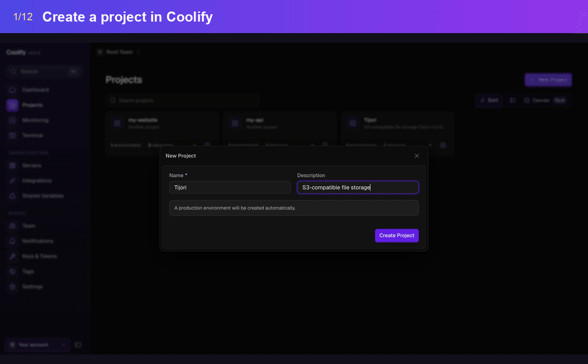

<small>Prefer video? [Download the MP4](images/coolify/coolify-walkthrough.mp4).</small>

## How it fits together

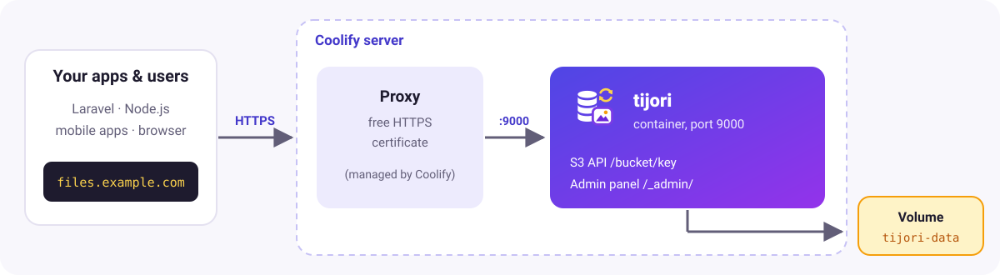

- Your apps and users only use **your domain**.
- Coolify's proxy forwards traffic to Tijori's port `9000` (and gets an HTTPS certificate when
  you use your own domain).
- Files live in the Docker volume **`tijori-data`**. They survive restarts, redeploys and upgrades.

## Before you start

- A server with Coolify installed.
- Nothing else. Coolify gives Tijori a free test address like
  `http://tijori-….YOUR-SERVER-IP.sslip.io`. For real use, add your own domain later (step 9) to get HTTPS.

## 1. Create a project

**Projects → + New Project**, name it `Tijori`, then **Create Project**. Coolify creates a
`production` environment for it.

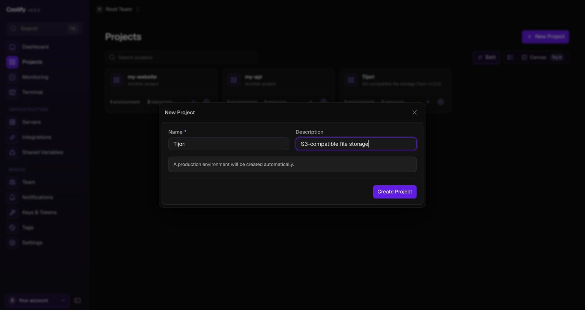

## 2. Add a Docker Compose resource

In the environment click **+ New Resource**. Type `compose` in the search box and click
**Deploy** on **Docker Compose** ("without a Git repository").

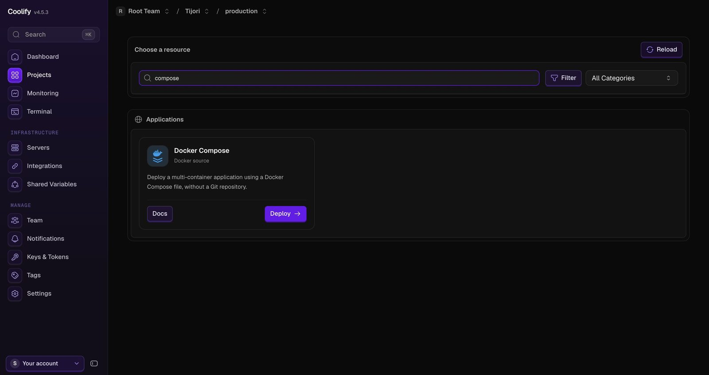

## 3. Paste the Compose file and create the service

Paste this into **Docker Compose file**, then click **Create Service**:

```yaml
services:
  tijori:
    image: ghcr.io/getsettalk/tijori:latest
    restart: unless-stopped
    environment:
      - SERVICE_URL_TIJORI_9000
      - TIJORI_PUBLIC_URL=${SERVICE_URL_TIJORI}
      - TIJORI_ADMIN_PASSWORD=${SERVICE_PASSWORD_ADMIN}
      - TIJORI_ACCESS_KEY=${TIJORI_ACCESS_KEY:-}
      - TIJORI_SECRET_KEY=${TIJORI_SECRET_KEY:-}
    volumes:
      - tijori-data:/data
    healthcheck:
      test: ["CMD", "/usr/local/bin/tijori", "healthcheck"]
      interval: 30s
      timeout: 5s
      retries: 3

volumes:
  tijori-data:
```

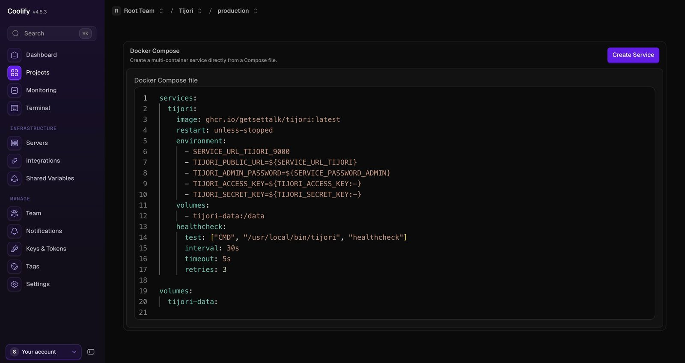

The same file with comments is in the repository:
[deploy/coolify/docker-compose.yml](https://github.com/getsettalk/Tijori/blob/main/deploy/coolify/docker-compose.yml).

| Line | What Coolify does with it |
| --- | --- |
| `SERVICE_URL_TIJORI_9000` | Gives the `tijori` service a domain and sends its traffic to port `9000`. |
| `${SERVICE_URL_TIJORI}` | Fills in the full address, used for links in the admin panel. |
| `${SERVICE_PASSWORD_ADMIN}` | Generates a strong admin password once and keeps it. |
| `${TIJORI_ACCESS_KEY:-}` | An optional, empty variable you can fill in later. |

There is no `ports:` section on purpose: Coolify's proxy handles traffic.

## 4. Find your admin password

The service opens on **General**. Under **Service configuration**, **Admin · Password** is the
password for the user **`admin`**. Use the copy button.

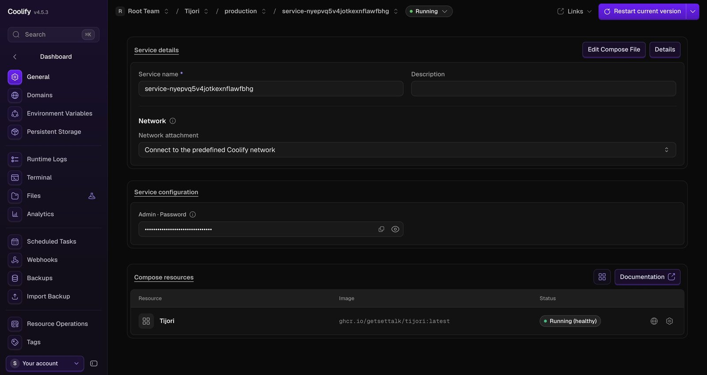

## 5. Check the domain

**Domains** shows the address Coolify generated, with **Internal port 9000**. You don't need to
change anything to try Tijori.

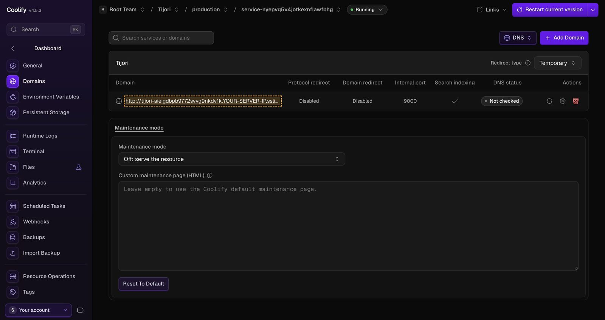

**Environment Variables** shows what Coolify created from the file (values are hidden):

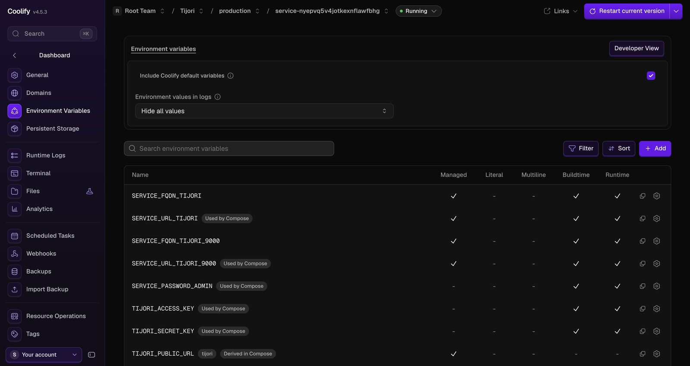

## 6. Deploy

Click **Deploy** (top right). Coolify pulls the image, creates the `tijori-data` volume and starts
the container. The status turns **Running (healthy)** a few seconds later.

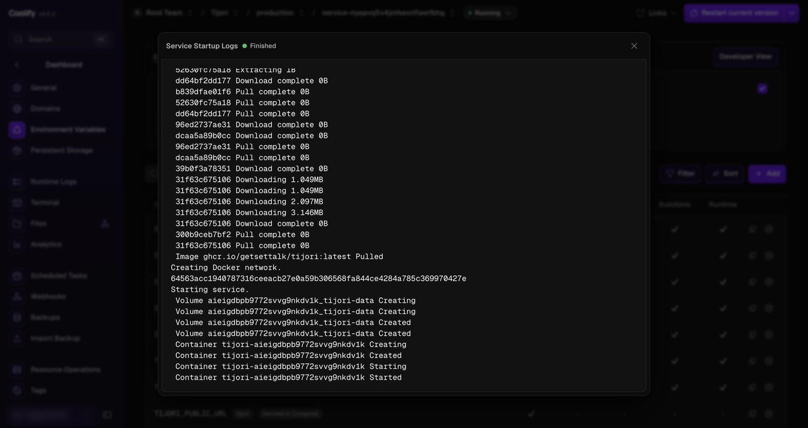

**Runtime Logs** should show `Tijori started`, `S3 endpoint ready` and `admin panel ready`:

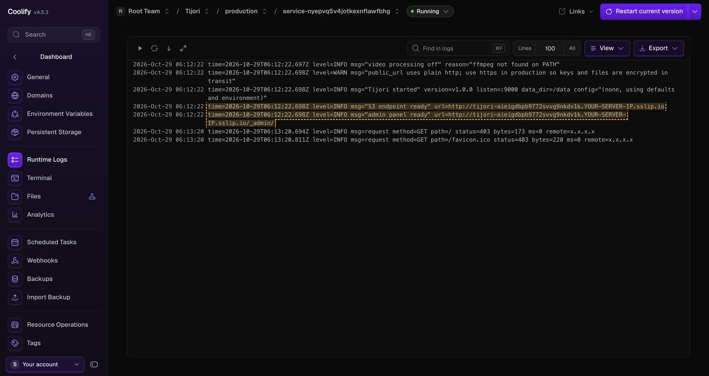

The warning `public_url uses plain http` is expected with the free test address. It goes away
when you add your own domain with HTTPS (step 9).

## 7. Open the admin panel

Open your domain with `/_admin/` at the end, for example
`http://tijori-….YOUR-SERVER-IP.sslip.io/_admin/`, and log in as `admin` with the password from step 4.

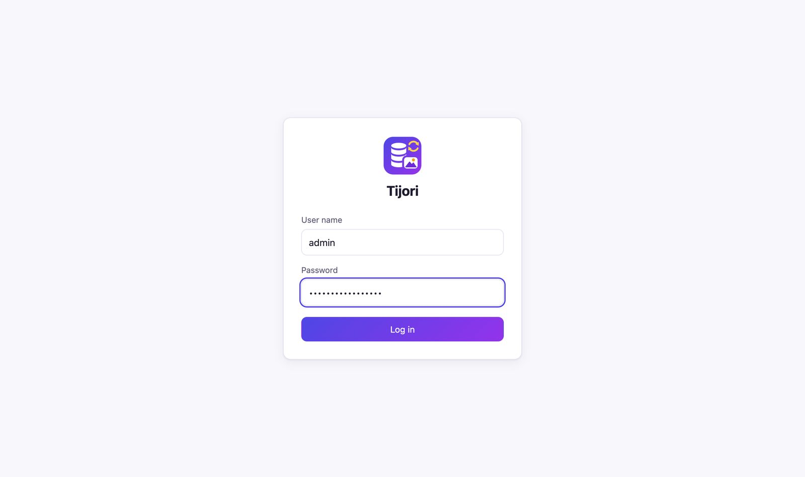

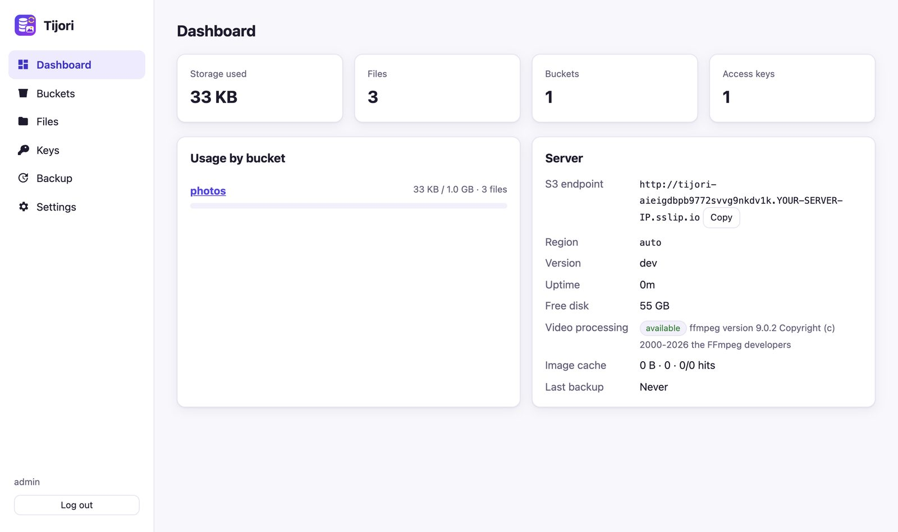

!!! tip "Page blocked in your browser?"
    Some ad blockers block `*.sslip.io` addresses (`ERR_BLOCKED_BY_CLIENT`). Allow the address in
    the extension, or use your own domain.

## 8. Create a bucket and a key, upload files

1. **Buckets → + New bucket**: name `photos`, quota `1GB`, tick **Public** if anyone may download.

    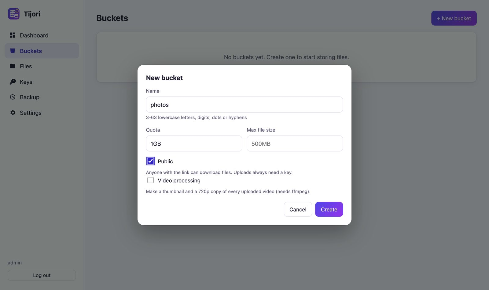

2. **Keys → + New key**: name it after your app. Copy the secret now; it is shown only once. The
   dialog already contains working Laravel `.env` and Node.js settings for your domain.

    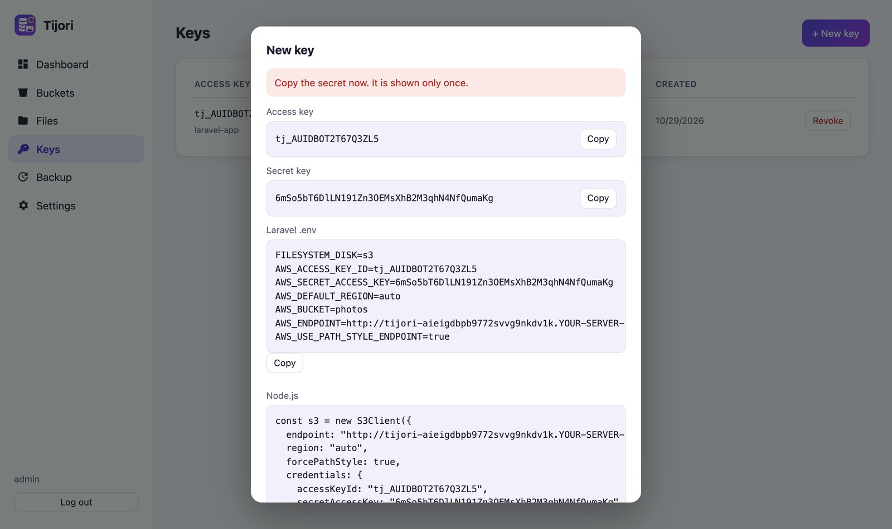

3. **Files**: drag files onto the page to upload. Images get thumbnails. **Share link** creates a
   link that expires.

    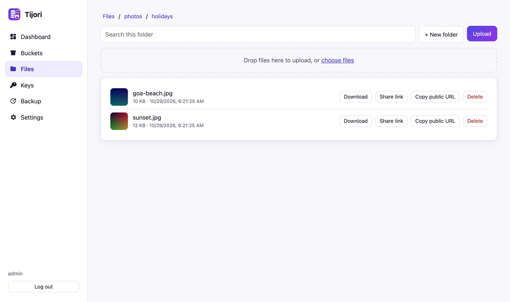

    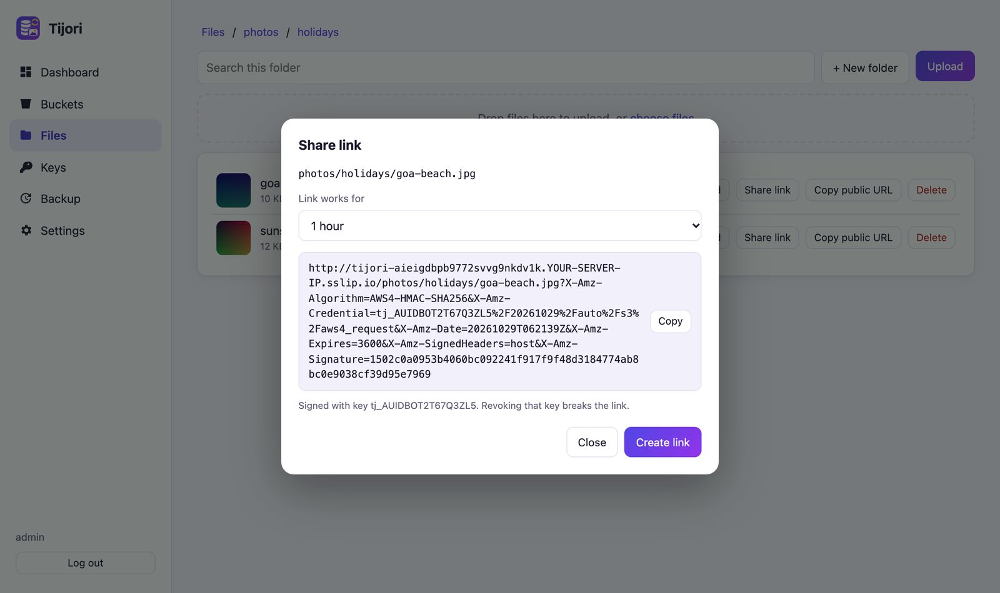

Check from a terminal:

```sh
curl http://tijori-….YOUR-SERVER-IP.sslip.io/health
# {"status":"ok"}
```

## 9. Use your own domain (HTTPS)

1. Point a DNS **A record** for, say, `files.example.com` to your server's IP.
2. In Coolify, open **Domains → + Add Domain**: protocol **https**, domain `files.example.com`,
   port **9000**, then **Save**. You can remove the generated sslip.io domain.

    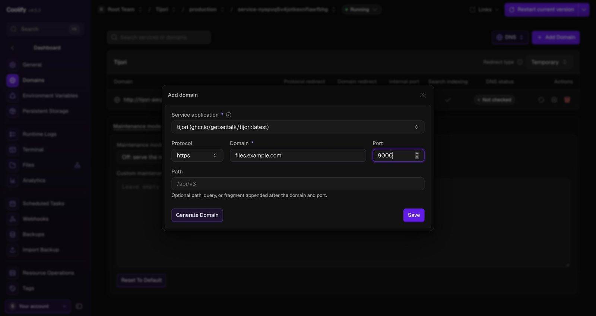

3. Click **Restart** (or **Redeploy**). `TIJORI_PUBLIC_URL` now uses your domain, and Coolify gets
   the HTTPS certificate.

Your apps use `https://files.example.com` as the endpoint. They never type `:9000`.

## Connect your app

```env
AWS_ENDPOINT=https://files.example.com
AWS_DEFAULT_REGION=auto
AWS_USE_PATH_STYLE_ENDPOINT=true
AWS_ACCESS_KEY_ID=tj_...
AWS_SECRET_ACCESS_KEY=...
AWS_BUCKET=photos
```

See [Laravel](laravel.md), [Node.js](nodejs.md) and [Mobile apps](mobile.md). Browser apps that
upload with presigned URLs also need `TIJORI_CORS_ORIGINS=https://your-app.example.com` (add it
under **Environment Variables**, then restart).

## Upgrading

The admin panel shows the running version at the bottom of the sidebar (top bar on phones) and on
the **Dashboard** and **Settings** pages, with the commit and build date. When a newer release is
out it says **Update available: vX.Y.Z** with a link to the release notes.

Tijori keeps your files in the `tijori-data` volume, so upgrades are safe:

- With `image: ghcr.io/getsettalk/tijori:latest`, use **Redeploy** to pull the newest image.
- For controlled upgrades, pin a version such as `ghcr.io/getsettalk/tijori:1.0.1` in
  **Edit Compose File** and change it when you want.
- After the redeploy, reload the admin panel: the version at the bottom of the sidebar shows the
  new number.

## Video processing

Change the image to `ghcr.io/getsettalk/tijori:latest-ffmpeg`, redeploy, then turn on
**Video processing** for a bucket in the Tijori admin panel.

## Backups and moving to another server

- **Scheduled backups:** add `TIJORI_BACKUP_TO` (for example `s3://my-backups?endpoint=https://...`),
  `TIJORI_BACKUP_SCHEDULE=daily 03:00`, and for S3 destinations `TIJORI_BACKUP_ACCESS_KEY` and
  `TIJORI_BACKUP_SECRET_KEY`. Restart.
- **One-file export:** in Coolify's **Terminal** for the service run
  `tijori export --out /data/export.tar.gz`, then copy the file off the server.
- **Move:** deploy Tijori on the new server, copy `export.tar.gz` into its `/data`, run
  `tijori import --force /data/export.tar.gz` in its terminal, and restart.

See [Backup, restore and moving servers](backup.md).

## Security checklist for Coolify

- Use your own domain with **https** before real use (step 9).
- To change the admin password, edit `SERVICE_PASSWORD_ADMIN` under **Environment Variables**
  and restart; Tijori picks up the new password on start.
- Give every app its own key, limited to its bucket. Revoke test keys.
- If someone else could see your screen or logs, rotate the admin password and keys.

## Long uploads and the 60-second proxy limit

Coolify's proxy (Traefik v3) cuts every request after **60 seconds** by default and answers
`499 Client Closed Request`. A 40 MB upload on a slow connection takes longer than that.

- **Admin panel (1.0.1+):** big files are sent in parts of about 15 seconds each, with retries,
  so uploads of any size work. Nothing to do.
- **Apps:** S3 SDKs switch to multipart uploads for big files (`Upload` in `@aws-sdk/lib-storage`,
  `upload_file` in boto3), which keeps each request short.
- **Raise the limit** if your apps send big files in one request: in Coolify open
  **Servers → your server → Proxy**, add these two lines to the proxy's `command:` list, save, and
  click **Restart Proxy** (all apps on that server reconnect, so pick a quiet moment):

    ```yaml
    - '--entrypoints.http.transport.respondingTimeouts.readTimeout=600s'
    - '--entrypoints.https.transport.respondingTimeouts.readTimeout=600s'
    ```

    `600s` allows 10-minute requests. `0` removes the limit, which also removes a protection
    against slow-request attacks, so prefer a number.

## Troubleshooting

| Problem | Fix |
| --- | --- |
| Upload fails with **499** after about a minute | Coolify's proxy (Traefik) stops any request after **60 seconds**. Since 1.0.1 the admin panel uploads big files in small parts, so this no longer happens there; SDKs use multipart for big files. For apps that send large files in one request over slow links, raise the proxy limit (below). |
| The domain shows `AccessDenied` XML | That is the S3 API, which needs a key. Open `/_admin/` for the admin panel (1.0.1 redirects there for you). |
| "No Available Server" or 502 | The service is not healthy yet, or the domain's port is not `9000`. Check **Runtime Logs**. |
| `ERR_BLOCKED_BY_CLIENT` in the browser | An ad blocker blocks `sslip.io`. Allow it, or use your own domain. |
| Login says the password is wrong | User `admin`, password from **General → Admin · Password**. |
| `SignatureDoesNotMatch` from your app | Endpoint must be just the domain (no bucket, no `:9000`), path-style on. |
| Browser upload fails with a CORS error | Set `TIJORI_CORS_ORIGINS` to your web app's address and restart. |
| Uploads over 100 MB fail with 413 | Cloudflare's proxy (orange cloud) limits uploads to 100 MB on the free plan. Use multipart uploads (SDKs do this automatically) or turn the proxy off for this domain. |
| Deploy fails with a config error | `TIJORI_ACCESS_KEY` and `TIJORI_SECRET_KEY` must both be set or both be empty. |
