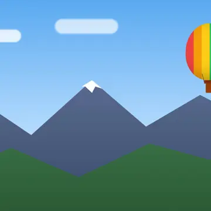
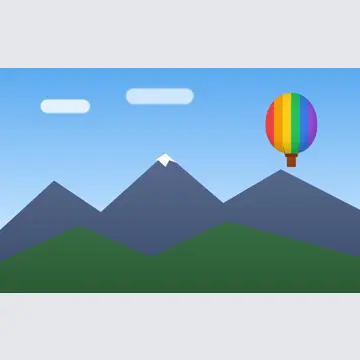
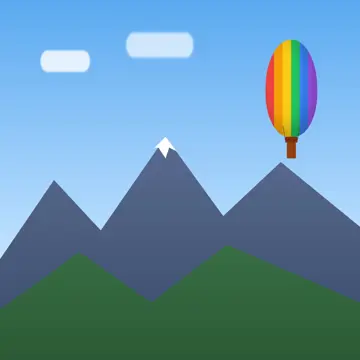
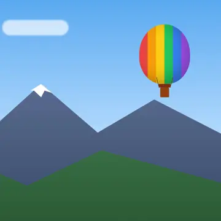
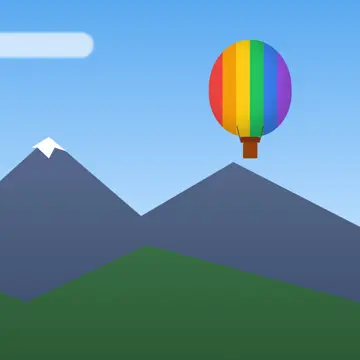

# Image resizing

**You will:** get resized, cropped and converted versions of your images just by changing the URL.

```text
https://files.example.com/img/<bucket>/<key>?w=300
```

The original is never changed. Results are cached on disk, so the second request is instant (the
response header `X-Tijori-Cache` says `HIT`).

**You get back the format you uploaded:** JPEG stays JPEG, PNG stays PNG, WebP stays WebP and GIF
stays GIF, and animated GIF and WebP files stay animated. Ask for another format with `fmt`.

## Quick recipes

| You want | URL parameters |
| --- | --- |
| A smaller copy, 800 px wide | `?w=800` |
| A square thumbnail that keeps the subject | `?w=300&h=300&fit=cover&pos=smart` |
| A square avatar from a portrait, keeping the head | `?w=200&h=200&fit=cover&pos=top` |
| A banner, focused on a known point | `?w=1200&h=400&fit=cover&fp=0.7,0.3` |
| Every product image the same size, nothing cut off | `?w=600&h=600&fit=pad&bg=ffffff` |
| The smallest file each browser can show | `?w=800&fmt=auto` |
| Sharp images on phones and Retina screens | `?w=400&dpr=2` |
| A still preview of an animated GIF | `?w=300&anim=0` |

## All parameters

| Parameter | Values | Meaning |
| --- | --- | --- |
| `w`, `h` | pixels | Width and height of the result. Give one to keep the aspect ratio. Images are never made larger than the original (except `fit=fill`). |
| `fit` | `contain` (default), `cover`, `pad`, `fill` | How the image goes into a `w` × `h` box. See [Fit](#fit-how-the-image-fills-the-box). |
| `pos` | `center` (default), `top`, `bottom`, `left`, `right`, `top-left`, `top-right`, `bottom-left`, `bottom-right`, `smart` | Which part to keep with `fit=cover`, or where to place the image with `fit=pad`. `gravity` is accepted as a synonym. |
| `fp` | `x,y`, each 0 to 1 | Focal point: keep this spot in the middle of a `cover` crop. `fp=0.5,0.2` is the middle, near the top. |
| `crop` | `x,y,width,height` | Cut this rectangle (in pixels of the original, after it is turned upright) before anything else. |
| `fmt` | `jpeg`, `png`, `webp`, `gif`, `auto` | Output format. Default: the same as the original. `auto` sends WebP to browsers that accept it. |
| `q` | 1–100 (default 80) | Quality for JPEG and WebP. |
| `lossless` | `1` | Lossless WebP (larger, pixel-perfect). Lossless WebP originals stay lossless automatically. |
| `bg` | hex colour (`fff`, `ffffff`, `000000cc`) or `transparent` | Colour of the bars added by `fit=pad`, and of transparent areas in JPEG output (default white). |
| `dpr` | 1, 1.5, 2, 2.5, 3, 3.5, 4 | Device pixel ratio: multiplies `w` and `h`. |
| `rot` | 90, 180, 270 | Rotate clockwise. |
| `flip` | `h`, `v`, `hv` | Mirror horizontally, vertically or both. |
| `anim` | `0` | Only the first frame of an animation. |

Unknown parameters are ignored, so you can add your own cache buster such as `&v=2`.

## Fit: how the image fills the box

The original, 1600 × 1000:


All of these ask for a 360 × 360 box:

| `fit=contain` (default) | `fit=cover` | `fit=pad&bg=e5e7eb` | `fit=fill` |
| --- | --- | --- | --- |
|  |  |  |  |
| The whole image fits inside the box; one side may be shorter. | The box is filled; the parts that don't fit are cut off. | The whole image, with bars to make the exact size. | Stretched to the exact size; the shape changes. |

## Choosing what a crop keeps

`fit=cover` cuts from the centre by default, which can cut off the subject (above, the balloon).
Tell Tijori what to keep:

| `pos=smart` | `fp=0.8,0.25` | `crop=1100,40,440,440&w=360` |
| --- | --- | --- |
|  |  |  |
| Tijori finds the subject. | You say where the subject is. | You give the exact rectangle. |

- **`pos=smart`** looks for what stands out: colours that differ from their surroundings, detail and
  skin tones. Even areas such as sky, walls and floors, and lines across the whole picture such as a
  horizon, count for little, and the crop avoids cutting objects in half. It works well for products,
  people and landscapes. For the best result on a specific image, store a focal point with it and use
  `fp`.
- **`pos=top`** (and the other positions) keep one side: `top` is a good default for portraits and
  people, since heads are usually near the top.
- **`fp=x,y`** keeps an exact spot in the middle of the crop, as far as the image allows. Values are
  fractions of the width and height: `0,0` is the top-left corner, `1,1` the bottom-right.
- **`crop=x,y,w,h`** cuts an exact rectangle first; `w`, `h` and `fit` then apply to that rectangle.
  Coordinates are pixels of the original after it is turned upright. A rectangle outside the image
  gives an error.


## Formats

| Original | Default output | With `fmt=auto` |
| --- | --- | --- |
| JPEG | JPEG | WebP if the browser accepts it, otherwise JPEG |
| PNG | PNG | WebP if accepted, otherwise PNG |
| WebP | WebP (lossless stays lossless) | WebP if accepted, otherwise JPEG (PNG when transparent) |
| GIF | GIF (animations kept) | WebP if accepted (animations kept), otherwise GIF |

- WebP is usually 25–35 % smaller than JPEG at the same quality and supports transparency and
  animation. Every current browser shows it.
- `fmt=auto` reads the browser's `Accept` header and answers with `Vary: Accept`, so CDNs and
  browsers keep the versions apart.
- Transparency is kept in PNG, WebP and GIF. In JPEG, transparent areas become white, or the `bg`
  colour.
- Inputs can be JPEG, PNG, GIF or WebP. Phone photos are turned upright automatically (EXIF
  orientation, in JPEG and WebP).

## Animations

Animated GIF and WebP files stay animated, with their timing and repeat count. You can convert
between them: `fmt=webp` turns a GIF into an animated WebP, often less than half the size.

- `anim=0` returns only the first frame, for example for list thumbnails.
- To protect the server, an animation is resized frame by frame only while frames × width × height
  stays under 25 million pixels (or `max_pixels`, if lower). Larger animations get their first frame,
  and the response explains why in an `X-Tijori-Note` header.

## Retina and high-DPI screens

`dpr=2` doubles `w` and `h` (up to `max_width` and `max_height`). In HTML:

```html

```

## Building URLs in your app

=== "JavaScript"

    ```js
    // img("photos", "2024/beach.jpg", { w: 300, h: 300, fit: "cover", pos: "smart" })
    export function img(bucket, key, params = {}) {
      const path = key.split("/").map(encodeURIComponent).join("/");
      const query = new URLSearchParams(params).toString();
      return `${process.env.TIJORI_URL}/img/${bucket}/${path}${query ? "?" + query : ""}`;
    }
    ```

=== "Laravel (PHP)"

    ```php
    // img('photos', 'avatars/a.jpg', ['w' => 200, 'h' => 200, 'fit' => 'cover', 'pos' => 'top'])
    function img(string $bucket, string $key, array $params = []): string
    {
        $path = implode('/', array_map('rawurlencode', explode('/', $key)));
        $query = $params ? '?'.http_build_query($params) : '';
        return rtrim(config('filesystems.disks.s3.endpoint'), '/')."/img/{$bucket}/{$path}{$query}";
    }
    ```

## Who can see resized images?

- **Public buckets:** anyone, like the originals.
- **Private buckets:** use a presigned URL for the `/img/...` address (the query parameters are
  part of what is signed).

## Settings

```toml
[images]
enabled = true
max_width = 4000            # largest w (after dpr)
max_height = 4000
max_pixels = 50000000       # refuse bigger originals (protects memory)
max_input_size = "50MB"
quality = 80                # default q
cache_size = "500MB"        # oldest unused results are removed first
allowed_widths = [150, 300, 600, 1200]   # optional: stops strangers filling the cache
```

With `allowed_widths`, every other `w` is refused. Other parameters (`h`, `fit`, `pos`, `fmt`…) still
create variants, so a public bucket with many images can still use a lot of cache space; the
`cache_size` limit always applies.

## Caching

- Results are stored in the data folder under `.cache/images` and reused until the original changes
  (the cache key includes the original's ETag) or the cache is full.
- Responses for public buckets send `Cache-Control: public, max-age=31536000` and an `ETag`, and answer
  `If-None-Match` with `304 Not Modified`. Private buckets send `private, max-age=86400`.
- If you replace an image under the same name, browsers may still show their old copy. Add a version
  to the URL (`&v=2`) or upload under a new name.
- After an upgrade that improves processing, Tijori renders images again instead of reusing old
  results.

## Errors

| Status | When |
| --- | --- |
| `400` | A parameter is wrong (the message says which), or `crop` lies outside the image. |
| `403` | Private bucket without a valid presigned URL. |
| `404` | The image does not exist. |
| `413` | The original is larger than `max_input_size`. |
| `415` | The file is not a JPEG, PNG, GIF or WebP image. |
| `422` | The original has more pixels than `max_pixels`. |
